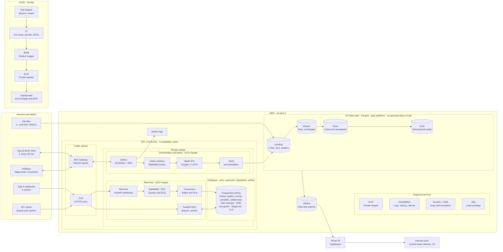

# Architecture of the control tower

This is the **reference architecture** of CargaExpress Control Tower, drawn by the team in draw.io. It shows how data
enters (webhooks, polled APIs and files), how it is processed in real time and in batch, where it is stored, and how it
reaches the people who use it. The editable source is
[`cargaexpress-architecture.drawio`](pathname:///files/cargaexpress-architecture.drawio) (page *ARQUITECTURE* is this diagram;
page *DATABASE_MODEL_DER* is the [data model](./data-model.md#entity-relationship-diagram)).

:::note Target design versus code
The diagram is the **target**. The repositories reviewed contain the FastAPI service, PostgreSQL, the order and status-mapping
APIs, Docker and the simulators. The pieces marked "Not found" in [What exists today](#what-exists-today) are not built yet.
:::

## The diagram

The diagram is wide. [Open the full-size image](pathname:///img/aws-architecture.png) to read every label.

## How to read it

| Area | What it does |
|---|---|
| **Sources and clients** | Five carriers push webhooks (type A), four expose REST APIs polled every 30 minutes (type B), files arrive from carriers, contracts and the DataCo history, brands and carriers call our APIs, and public holidays come from Nager.Date for 3 countries |
| **Public subnet** | The load balancer is the HTTPS entry. The NAT gateway lets private components reach the internet (to poll APIs and download holidays) without being exposed |
| **Real time (ECS Fargate)** | The receiver accepts webhooks, RabbitMQ queues them (with a dead-letter queue), consumers apply states and SLA, and the FastAPI APIs serve brands and carriers |
| **Database** | One PostgreSQL instance on RDS holds four databases: `wms`, `opersolon`, `liquidsolon` and `airflow`. It stores orders, guides, events, penalties and settlements, with automatic backups, KMS encryption, TLS and a single availability zone |
| **Orchestration and batch (ECS Fargate)** | Airflow schedules the work, Celery workers (RabbitMQ as broker) run it, Spark does the ETL, and the seed and simulators generate test data |
| **S3 data lake** | Landing, Bronze (raw, unchanged), Silver (clean and normalized) and Gold (dimensional model), in Parquet and partitioned by date, with no personal data in Gold |
| **Analytics** | Athena queries the lake and Power BI shows the dashboard to the control tower, finance and distribution centers |
| **Regional services** | ECR for private images, CloudWatch for logs, metrics and alarms, Secrets Manager with KMS, and IAM with least privilege |
| **CI/CD (GitHub)** | Pull request and review, then CI (lint, tests, secrets scan, DAG checks), Docker build, push to ECR and deployment to ECS Fargate and EKS |

## The paths data follows

| Path | Route |
|---|---|
| **Webhook (type A)** | Carrier → ALB → receiver → RabbitMQ → consumers → PostgreSQL |
| **API call** | Brand or carrier → ALB → FastAPI APIs ↔ PostgreSQL |
| **Polled API (type B)** | Airflow → NAT gateway → carrier API, every 30 minutes |
| **Holidays** | Airflow → NAT gateway → Nager.Date |
| **Files and history** | Flat files and seed → Landing → Bronze → Silver → Gold → Athena → Power BI |

The detail of each stage is in [Data flow](../sprint-1/data-flow.md) and the reasons behind the main choices are in the
[decision records](../decisions/index.md): [ADR-0007](../decisions/0007-immutable-raw-events.md),
[ADR-0008](../decisions/0008-three-ingestion-modalities.md) and [ADR-0009](../decisions/0009-data-lake-and-star-schema.md).

## What exists today

| Piece | Status in the repositories reviewed |
|---|---|
| FastAPI APIs and PostgreSQL | Built. See [Implemented backend](./overview.md) |
| Status mapping and orders | Built in `main`. See [Sprint 2 · week 1](../sprint-2/week-1.md) |
| Webhook and file simulators | In feature branches or standalone. See [Sprint 2 · week 2](../sprint-2/week-2.md) |
| RabbitMQ | Docker Compose service in a feature branch |
| Receiver, consumers, SLA and penalties | Not found |
| Airflow, Celery, Spark, S3 data lake, Athena, Power BI | Not found |
| AWS deployment and CI/CD | Not found |

## Differences from the Sprint 1 version

The first version of this design is described in [Architecture v1](../sprint-1/architecture-v1.md). This diagram is the later
one and is the reference when they differ:

| Topic | Sprint 1 page | This diagram |
|---|---|---|
| AWS region | us-east-1 | **us-east-2** |
| Databases | One PostgreSQL | Four databases on one RDS instance: `wms`, `opersolon`, `liquidsolon`, `airflow` |
| Deployment target | ECS Fargate | ECS Fargate **and EKS** |
| Inputs | WMS, contracts, holidays | Adds the DataCo history and API clients, and names Nager.Date for holidays |
| Logs | CloudWatch | Adds Airflow logs as a separate output |

## Related

[Architecture v1](../sprint-1/architecture-v1.md) · [Costs](../project/costs.md) · [Data model](./data-model.md) ·
[Project status](../project/status.md)
