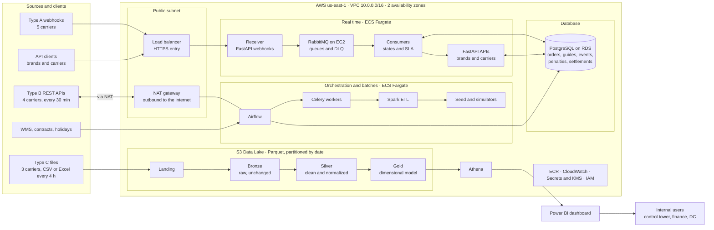

# End-to-end architecture v1

**Story:** `US-03` · RIWI-19 · *Define End-to-End Architecture v1* · Owner: Alexandra Peña Orozco · Epic: Architecture and
Data Model · Subtasks: RIWI-22 (end-to-end flow), RIWI-23 (push, pull and file integration), RIWI-24 (initial ADRs)

:::info A later version exists
The team's later diagram, with the final region, databases and CI/CD targets, is in
[Architecture (AWS)](../architecture/aws-architecture.md#differences-from-the-sprint-1-version). Where the two differ, that page is the
reference. This page keeps the Sprint 1 design as it was defined.
:::

This is the **target design** of the control tower. It is the blueprint that sprint 2 starts to build. What exists in code
today is described in [Implemented backend](../architecture/overview.md).

## The big picture

## Layers

| Layer | Responsibility | Technology |
|---|---|---|
| **Entry** | Receive HTTPS traffic from carriers and API clients | Load balancer in a public subnet |
| **Real-time processing** | Receive webhooks, queue them, apply states and SLA, serve the APIs | FastAPI receiver and APIs, RabbitMQ, consumers, on ECS Fargate |
| **Operational database** | Orders, guides, events, penalties and settlements | PostgreSQL on RDS, automated backups, KMS encryption, TLS, single availability zone |
| **Orchestration and batch** | Poll type B APIs, load type C files, scheduled loads, ETL, seed | Airflow, Celery workers, Spark on ECS Fargate |
| **Analytics** | Trusted history and reporting without personal data | S3 data lake (Landing, Bronze, Silver, Gold), Athena, Power BI |
| **Platform** | Images, logs, secrets, access control | ECR, CloudWatch, Secrets Manager with KMS, IAM with least privilege |
| **Delivery** | Review, test and deploy | GitHub: pull request, CI, Docker build, ECR, deploy to ECS Fargate |

## Two paths for the data

| Path | Purpose | Freshness |
|---|---|---|
| **Hot path** | Views in PostgreSQL, APIs for brands and carriers, alerts for at-risk orders | About 5 minutes |
| **Cold path** | Spark and the data lake (Gold), the star schema, Athena and Power BI, comparison with the DataCo history | Historical |

## Three ways data enters

| Modality | Carriers | Source | How it is ingested | Where it lands |
|---|---|---|---|---|
| **A · push** | 5 | Webhooks | Receiver answers immediately, queues in RabbitMQ and retries | `raw_event`, plus a copy in S3 Bronze |
| **B · pull** | 4 | REST APIs | An Airflow DAG polls every 30 minutes, respecting rate limits | `raw_event` |
| **C · file** | 3 | CSV or Excel every 4 hours | An Airflow DAG validates and cleans the files, which first land in S3 Landing | `raw_event` |

The scheduled loads of the WMS, holidays (Nager.Date, 3 countries) and contracts (SLAs in Excel) run daily or monthly. The
detail of each stage is in [Data flow](./data-flow.md).

## Design rules stated in the diagram

- The state mapping is configurable in the database, versioned, and changes **without redeploying**.
- A webhook that fails **5 times** goes to the dead-letter queue (DLQ) with an alarm and is reprocessed without losing the event.
- Gold data contains **no personal data**.
- Parquet files are partitioned by date.
- Database backups are automatic and encrypted, and connections use TLS.

## Cost

The estimated infrastructure cost is about USD 460 per month. See [Costs](../project/costs.md).

## Decisions behind this design

| Decision | Record |
|---|---|
| Raw events are stored unchanged and de-duplicated by hash | [ADR-0007](../decisions/0007-immutable-raw-events.md) |
| Three ingestion modalities converge on one raw store | [ADR-0008](../decisions/0008-three-ingestion-modalities.md) |
| Data lake in layers and a star schema for analytics | [ADR-0009](../decisions/0009-data-lake-and-star-schema.md) |
| Everything stored in UTC with calendar and cut-off by country | [ADR-0010](../decisions/0010-utc-and-business-calendars.md) |

## What was built from it

| Piece | Status in the repositories reviewed |
|---|---|
| FastAPI service, PostgreSQL, Docker | Built in sprint 1 and 2. See [Backend foundations](./backend-foundations.md) |
| Status mapping | Built in sprint 2. See [Sprint 2 · week 1](../sprint-2/week-1.md) |
| RabbitMQ in Docker Compose | In a feature branch. See [Sprint 2 · week 2](../sprint-2/week-2.md) |
| Webhook receiver, consumers, SLA, penalties, settlement | Not found. See [Project status](../project/status.md) |
| Airflow, Spark, S3 data lake, Athena, Power BI | Not found |
| AWS deployment and CI/CD | Not found |
