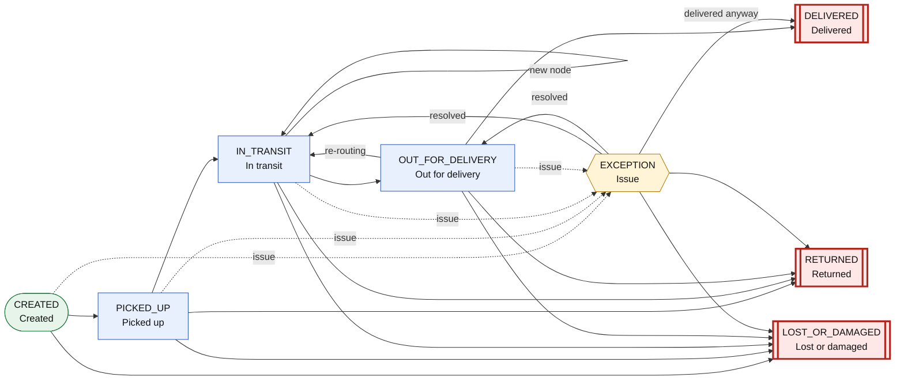
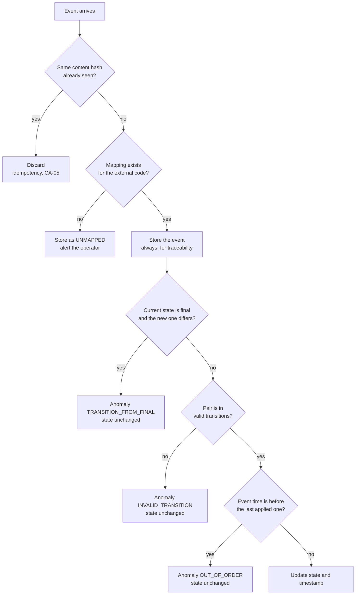

# Canonical state catalog

**Story:** `US-02` · RIWI-12 · *Design the Canonical State Catalog* · Owner: Julian Vanegas · Subtasks: RIWI-13, RIWI-14,
RIWI-15 · Traceability: RN-01, RN-02, E-15, CA-01, CA-05, CA-06

Every carrier names its statuses differently. The control tower translates all of them into **8 canonical states** so that
the whole system speaks one language. This page defines the states, the valid transitions, the mapping table and the rule
that protects final states.

## The 8 states

| State | Meaning | Type |
|---|---|---|
| `CREATED` | The order or guide exists in the WMS and has not been picked up | Initial |
| `PICKED_UP` | The carrier received the package at the distribution center (equals dispatch) | Active |
| `IN_TRANSIT` | Moving between the carrier's nodes | Active |
| `OUT_FOR_DELIVERY` | On the last-mile route to the recipient | Active |
| `EXCEPTION` | Issue: wrong address, customer absent, held at a carrier depot | Active (exception) |
| `DELIVERED` | Received by the recipient | **Final** |
| `RETURNED` | Sent back to the sender | **Final** |
| `LOST_OR_DAMAGED` | Lost or damaged | **Final** |

:::note One vocabulary
The first design documents named these states in Spanish. This documentation uses the English names, which are the names
stored by the backend, so the whole project speaks one language.
:::

## State diagram



**How to read it.** Follow the solid line across the top for the normal path: created, picked up, in transit, out for
delivery, delivered. The dotted lines are the *issue* loop: any active state can raise a `EXCEPTION`, which later returns to
transit or delivery, or ends in a final state. Red double-border boxes are **final states**: no arrow leaves them. A guide can
end as returned or lost from the states shown; the exact pairs are in the matrix below (for example `CREATED` cannot go
straight to `RETURNED`).

## Valid transitions

Row is the current state, column is the new state. ✔ is valid. ✘ is invalid and is recorded as an anomaly. A dash is the same
state.

| From \ To | `CREATED` | `PICKED_UP` | `IN_TRANSIT` | `OUT_FOR_DELIVERY` | `EXCEPTION` | `DELIVERED` | `RETURNED` | `LOST_OR_DAMAGED` |
|---|---|---|---|---|---|---|---|---|
| **`CREATED`** | – | ✔ | ✘ | ✘ | ✔ | ✘ | ✘ | ✔ |
| **`PICKED_UP`** | ✘ | – | ✔ | ✘ | ✔ | ✘ | ✔ | ✔ |
| **`IN_TRANSIT`** | ✘ | ✘ | ✔ repeated | ✔ | ✔ | ✘ | ✔ | ✔ |
| **`OUT_FOR_DELIVERY`** | ✘ | ✘ | ✔ re-routing | – | ✔ | ✔ | ✔ | ✔ |
| **`EXCEPTION`** | ✘ | ✘ | ✔ | ✔ | – | ✔ | ✔ | ✔ |
| **`DELIVERED`** | ✘ | ✘ | ✘ | ✘ | ✘ | – | ✘ | ✘ |
| **`RETURNED`** | ✘ | ✘ | ✘ | ✘ | ✘ | ✘ | – | ✘ |
| **`LOST_OR_DAMAGED`** | ✘ | ✘ | ✘ | ✘ | ✘ | ✘ | ✘ | – |

## Why the rules are the way they are

| Rule | Reason |
|---|---|
| **Final states have no outgoing transitions** (RN-02) | `DELIVERED`, `RETURNED` and `LOST_OR_DAMAGED` close the life of a guide. Delivery, SLA and penalties are calculated from them, so a late or wrong event must not reopen the guide |
| **`IN_TRANSIT` → `IN_TRANSIT` is valid** | A package moves through several carrier nodes. Each new node is a legitimate progress event, not an error, so it creates no anomaly |
| **`OUT_FOR_DELIVERY` → `IN_TRANSIT` is valid** (re-routing) | A package out for delivery can go back into the carrier's network to be routed again |
| **A repeated event with identical content is discarded** (CA-05) | The same message arriving twice is a retry, not a transition. It is dropped for idempotency and creates no anomaly |
| **An older event does not roll the state back** | An event dated before the current state is kept in the history and flagged `OUT_OF_ORDER` (out of order). The state does not move backwards |
| **An invalid transition does not change the state** | The event is still stored, so nothing is lost, and it is flagged `INVALID_TRANSITION` for review |
| **An unmapped carrier code does not block the flow** | The event is stored as `UNMAPPED` (unmapped) and the operator is alerted. New codes are detected without losing data |

## Mapping table

The mapping lives in the database, so changing it needs no redeployment (CA-06). A change closes the current row and inserts a
new version, which keeps the full history and allows rollback.

```sql
CREATE TYPE canonical_status AS ENUM (
  'CREATED','PICKED_UP','IN_TRANSIT','OUT_FOR_DELIVERY',
  'EXCEPTION','DELIVERED','RETURNED','LOST_OR_DAMAGED');

CREATE TABLE state_mapping (
  id                SERIAL PRIMARY KEY,
  carrier_id INT NOT NULL REFERENCES carrier(id),
  external_code    VARCHAR(60) NOT NULL,
  canonical_status   canonical_status NOT NULL,
  version           INT NOT NULL,
  valid_from     TIMESTAMPTZ NOT NULL DEFAULT now(),
  valid_to     TIMESTAMPTZ,            -- NULL = current
  created_by        VARCHAR(80) NOT NULL,
  change_reason     TEXT,
  UNIQUE (carrier_id, external_code, version)
);
```

A unique index on `(carrier_id, external_code)` where `valid_to IS NULL` guarantees one current translation per
carrier code. A second table, `valid_transition (desde, hacia)`, holds the valid pairs of the matrix.

### Example

Several external codes of the same carrier can converge into one canonical state. That is the "14 codes for delivered"
problem.

| Carrier | Mode | External code | Canonical state |
|---|---|---|---|
| TRANS-A1 | A (webhook) | `PICKED_UP` | `PICKED_UP` |
| TRANS-A1 | A | `IN_TRANSIT` | `IN_TRANSIT` |
| TRANS-A1 | A | `OUT_FOR_DELIVERY` | `OUT_FOR_DELIVERY` |
| TRANS-A1 | A | `DELIVERED` | `DELIVERED` |
| TRANS-A1 | A | `ADDRESS_ISSUE` | `EXCEPTION` |
| TRANS-A1 | A | `LOST` | `LOST_OR_DAMAGED` |
| TRANS-B1 | B (API) | `10` | `PICKED_UP` |
| TRANS-B1 | B | `20` | `IN_TRANSIT` |
| TRANS-B1 | B | `30` | `OUT_FOR_DELIVERY` |
| TRANS-B1 | B | `40` / `41` | `DELIVERED` |
| TRANS-B1 | B | `50` | `EXCEPTION` |
| TRANS-B1 | B | `60` | `RETURNED` |
| TRANS-C1 | C (file) | `Recolectado` (collected) | `PICKED_UP` |
| TRANS-C1 | C | `En ruta` (on route) | `IN_TRANSIT` |
| TRANS-C1 | C | `En distribución` (in distribution) | `OUT_FOR_DELIVERY` |
| TRANS-C1 | C | `Entregado` (delivered) / `Recibido conforme` (received in order) | `DELIVERED` |
| TRANS-C1 | C | `Cliente ausente` (customer absent) | `EXCEPTION` |
| TRANS-C1 | C | `Retenido en bodega` (held at the warehouse) | `EXCEPTION` |
| TRANS-C1 | C | `Devolución a origen` (return to origin) | `RETURNED` |

External codes are shown exactly as the carrier sends them. The type C codes are in Spanish, with the English meaning in brackets. Deliverable E-15 completes the 12 carriers,
each with at least 6 proprietary states.

## Decision algorithm for an incoming event (RN-02)



Anomalies are stored in `event_anomaly` with the event, the guide, the carrier, the current and received states and the
detection time. The types are `TRANSITION_FROM_FINAL`, `INVALID_TRANSITION`, `OUT_OF_ORDER`, `UNMAPPED` and
`LABEL_NOT_FOUND`. Anomalies per carrier feed the dashboard question *Which carriers have the most event anomalies?*

### Test cases

| Given | When | Then |
|---|---|---|
| Guide is `DELIVERED` (CA-01) | An "in transit" event arrives | State stays `DELIVERED`, event is stored, anomaly `TRANSITION_FROM_FINAL` |
| Guide is `RETURNED` | An `DELIVERED` event arrives | State stays `RETURNED`, anomaly `TRANSITION_FROM_FINAL` |
| Guide is `LOST_OR_DAMAGED` | An `OUT_FOR_DELIVERY` event arrives | State stays `LOST_OR_DAMAGED`, anomaly `TRANSITION_FROM_FINAL` |
| Guide is `DELIVERED` | The same event is repeated (CA-05) | Discarded for idempotency, no anomaly |
| The external code has no mapping | An event with a new code arrives | Stored as `UNMAPPED` and the operator is alerted |

## Acceptance criteria status

| Criterion | Status in the document |
|---|---|
| Mapping table designed and approved | Designed (DDL and examples). **Pending** approval by the team in peer review |
| Transition rules and final states documented | Complete: matrix, algorithm, RN-02 and test cases |
| Validated diagram of the 8 states | Created in draw.io. **Pending** validation by a second team member |

### Review feedback received

The story received review feedback on 28 September. It asked for the deliverable to be corrected before it counts as
complete:

1. Redesign the state diagram so it is clear and easy to read, with a visible difference between initial, intermediate,
   exception and final states.
2. Explain why the main transitions are valid or invalid, and connect that to the diagram.
3. Write the whole document in English, with terminology consistent with the application.
4. Validate the mapping table and get the diagram validated by a second team member.

This page responds to the first three points: the diagram is redrawn above, the reasons are in
[Why the rules are the way they are](#why-the-rules-are-the-way-they-are), and the page is in English. The two validations
still need people to sign off.

## Related

- [Business rules](./business-rules.md) · RN-01 and RN-02
- [Data model](./data-model.md) · `carrier_status_map`, `tracking_event` and the anomaly flag
- [ADR-0003](../decisions/0003-canonical-statuses-and-state-mapping.md)
