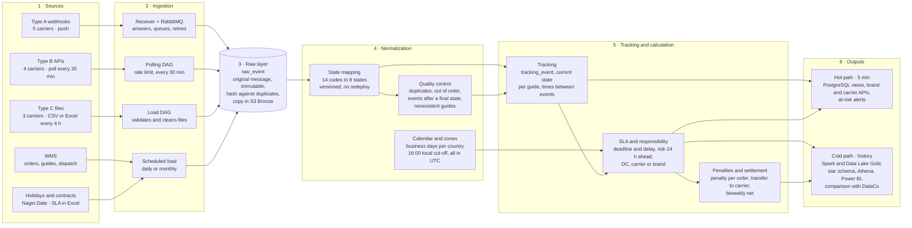

# From the carriers to the tower: data flow

Part of `US-03` (RIWI-22, *Map the end-to-end flow*, and RIWI-23, *Define integration for the 3 source modalities*) and of the
data model of `US-04`. Three ways of receiving data enter through different paths, but they all end in one flow.

## Six stages

## What happens at each stage

| Stage | What it does |
|---|---|
| **1 · Sources** | Five carriers push webhooks (type A), four expose REST APIs polled every 30 minutes (type B), three deliver CSV or Excel files every 4 hours (type C). The WMS provides orders, guides and dispatch, and the holiday calendar and contracts provide the SLA rules |
| **2 · Ingestion** | The receiver answers immediately, queues the message in RabbitMQ and retries. DAGs poll the APIs within their rate limit and load and clean the files. WMS, holidays and contracts load on a schedule, daily or monthly |
| **3 · Raw layer** | Every message is saved as `raw_event`: the original, never modified, with a hash that avoids duplicates, and a copy in S3 Bronze. This makes it possible to **reprocess** |
| **4 · Normalization** | Carrier codes become the 8 canonical states through a versioned table that changes without redeploying. Quality control catches duplicates, out-of-order events, events after a final state and guides that do not exist. The calendar applies business days per country and the 16:00 local cut-off, with everything stored in UTC |
| **5 · Tracking and calculation** | Tracking keeps the current state of each guide and the times between events. The SLA step calculates the deadline and the delay, flags risk 24 hours ahead and assigns the responsible party. Penalties are calculated per order, passed on to the carrier when it is responsible, and netted every half-month |
| **6 · Outputs** | The **hot path** serves views, APIs and alerts within about 5 minutes. The **cold path** feeds the data lake, the star schema, Athena and Power BI, and the comparison with DataCo |

## Two key answers

1. **Push, pull or file: it does not matter.** Everything ends as a `raw_event` and is normalized with the same rules,
   regardless of how it arrived.
2. **A webhook that fails 5 times** goes to the dead-letter queue (DLQ) with an alarm, and is reprocessed without being lost.

## What exists today

| Stage | Status |
|---|---|
| Webhook simulator for type A | Built, in a [standalone project](../simulator/overview.md) and in a feature branch |
| Type C file simulator | Built by `HU-19`, in a feature branch |
| RabbitMQ service | In a feature branch (`RIWI-111`) |
| State mapping and its admin API | Built. See [Sprint 2 · week 1](../sprint-2/week-1.md) |
| Receiver, DAGs, quality control, SLA, penalties, outputs | Not found in the repositories reviewed |

## Related

[Architecture v1](./architecture-v1.md) · [Data model](./data-model.md) · [SLA and delay](./sla-and-delay.md) ·
[ADR-0009](../decisions/0009-immutable-raw-events.md) · [ADR-0010](../decisions/0010-three-ingestion-modalities.md)
