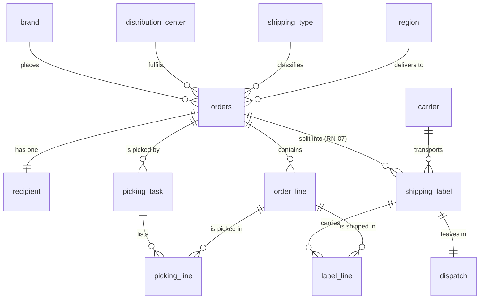
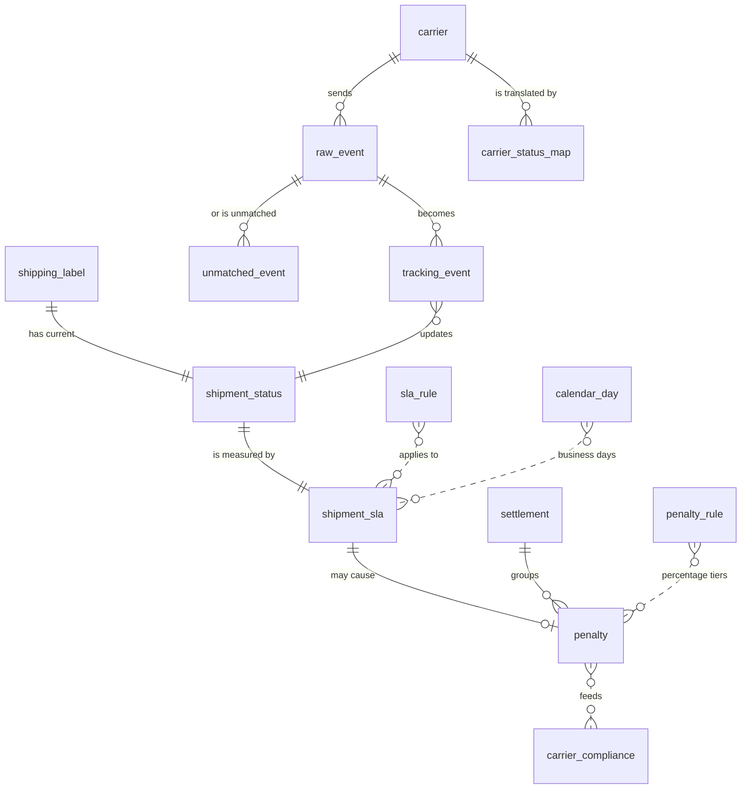
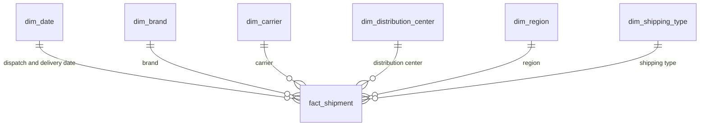

# Data model

**Story:** `US-04` · RIWI-25 · *Design the Operational Data Model (WMS)* · Owner: Alexandra Peña Orozco · Epic: Architecture
and Data Model · Subtasks: RIWI-26 (model the entities), RIWI-27 (one order, several guides, RN-07), RIWI-28 (validate
referential integrity)

The data design has three layers, each answering a different question:

| Layer | Question it answers | Where |
|---|---|---|
| **Operational WMS** | What was ordered, picked and dispatched? | [Below](#1-operational-wms) |
| **Control tower tracking** | Where is each guide, was it on time, who is responsible, what is owed? | [Below](#2-control-tower-tracking) |
| **Analytics star schema** | How are carriers, brands and regions performing over time? | [Below](#3-analytics-star-schema) |

The design diagrams use Spanish names. This page uses the English names, with the same meaning.

## 1. Operational WMS

An order belongs to one brand, one distribution center, one shipping type and one region, and it can be split into **several
shipping labels (guides)**. That one-to-many relationship is rule RN-07.

| Table | Purpose | Key columns |
|---|---|---|
| `brand` | Client brand | `brand_id`, `name`, `is_premium` |
| `distribution_center` | Warehouse that fulfils orders | `dc_id`, `name`, `city`, `country`, `time_zone` |
| `shipping_type` | Service type | `shipping_type_id`, `name` |
| `region` | Destination region | `region_id`, `name`, `country` |
| `carrier` | Transport carrier | `carrier_id`, `name`, `integration_type` (A, B or C), `status` |
| `orders` | The order | `order_id`, `brand_id`, `dc_id`, `shipping_type_id`, `region_id`, `brand_reference` (unique), `created_at` |
| `recipient` | Personal data of the receiver, isolated for RN-10 | `order_id`, `name`, `email`, `address`, `phone` |
| `shipping_label` | The guide | `label_id`, `order_id`, `carrier_id`, `tracking_number` (unique), `freight_value` |
| `dispatch` | One dispatch per guide | `dispatch_id`, `label_id` (one to one), `dispatched_at` |
| `order_line` | A product line of an order | `line_id`, `order_id`, `line_number`, `sku`, `quantity`, `unit_price` |
| `picking_task` | Warehouse picking work | `picking_id`, `order_id`, `started_at`, `completed_at`, `status` |
| `picking_line` | Quantity requested and picked per line | `picking_id`, `line_id`, `quantity_requested`, `quantity_picked` |
| `label_line` | Which lines and quantities travel in each guide | `label_id`, `line_id`, `quantity` |

### Integrity rules

- Foreign keys to the catalogs (brand, carrier, distribution center) use `ON DELETE RESTRICT`.
- Unique: `(brand_id, brand_reference)` and `(carrier_id, tracking_number)`.
- Checks: `quantity > 0` and `quantity_picked <= quantity_requested`.
- Dates are `timestamptz` in UTC, and the 16:00 cut-off follows the time zone of the distribution center.
- RN-07: an order meets the SLA only if all of its guides do.
- RN-10: personal data is isolated in `recipient`.

## 2. Control tower tracking

This layer goes from the carriers' events to the SLA, penalties and settlement. Tables marked WMS come from the layer above.

| Table | Purpose | Key columns |
|---|---|---|
| `raw_event` | Original message, never modified | `raw_id`, `carrier_id`, `integration_type`, `payload` (json), `received_at`, `hash` (unique) |
| `tracking_event` | Interpreted event | `event_id`, `raw_id`, `label_id`, `carrier_id`, `canonical_status`, `occurred_at`, `is_anomaly` |
| `shipment_status` | Current state of each guide | `label_id`, `current_status`, `updated_at`, `exception_open_since` |
| `carrier_status_map` | Versioned translation of carrier codes | `map_id`, `carrier_id`, `raw_status`, `canonical_status`, `valid_from`, `valid_to`, `version` |
| `unmatched_event` | Events for guides that do not exist in the WMS, with no foreign key on purpose | `unmatched_id`, `raw_id`, `carrier_id`, `tracking_number`, `reason` |
| `sla_rule` | Business days allowed | `rule_id`, `brand_id`, `shipping_type_id`, `region_id`, `business_days` |
| `shipment_sla` | Deadline, delay, responsible and risk per guide | `label_id`, `deadline`, `days_late`, `responsible_party`, `at_risk` |
| `calendar_day` | Business days and holidays per country | `country`, `date`, `is_business_day`, `is_holiday`, `cutoff_time` |
| `penalty_rule` | Percentage of freight per delay tier | `tier_id`, `days_from`, `days_to`, `freight_pct` |
| `penalty` | Penalty per guide | `penalty_id`, `label_id`, `days_late`, `brand_amount`, `passed_on_amount`, `responsible_party`, `settlement_id` |
| `settlement` | Half-month settlement per brand | `settlement_id`, `brand_id`, `period_start`, `period_end`, `payable_to_brand`, `receivable_from_carrier`, `net` |
| `carrier_compliance` | Compliance per carrier and half-month | `carrier_id`, `half_month`, `compliance_pct`, `under_review` |

### Design decisions

- `raw_event` is immutable and partitioned by month, and its hash avoids duplicates (CA-05).
- `tracking_event` is unique per `(carrier_id, label_id, canonical_status, occurred_at)`.
- A final state is never replaced: a later event is flagged as an anomaly (RN-02).
- `unmatched_event` keeps guides with no order in the WMS, without a foreign key on purpose.
- `carrier_status_map` changes without redeploying and keeps its versions (RN-01).
- Everything is in UTC, with the time zone and cut-off taken from the distribution center and the country (RN-03).
- A carrier below 85% for two half-months goes under review (RN-09).

## 3. Analytics star schema

The analytical layer (Gold) is a **star schema**, not a snowflake: flat dimensions that are simple for Power BI. The carrier
dimension keeps its history (slowly changing dimension type 2).

| Table | Kind | Purpose |
|---|---|---|
| `fact_shipment` | Fact | **One row per guide.** Keys to every dimension, the order and guide numbers, `days_in_transit`, `days_late`, `met_sla` and `freight_value` |
| `fact_order_sla` | Fact | One row per order: number of guides, guides on time, and whether all of them met the SLA |
| `fact_penalty` | Fact | Penalties: amount to the brand, amount passed on, responsible party and half-month |
| `fact_event` | Fact | Events: canonical state and anomaly flag |
| `dim_date` | Dimension | Date, country, business day, holiday, half-month, month. Used in two roles: dispatch and delivery |
| `dim_brand` | Dimension | Brand and whether it is premium |
| `dim_carrier` | Dimension (type 2) | Carrier with `valid_from`, `valid_to` and `is_current` to keep history |
| `dim_distribution_center` | Dimension | Distribution center, city, country, time zone |
| `dim_region` | Dimension | Region, country, time zone |
| `dim_shipping_type` | Dimension | Shipping type and its SLA in business days |

The other fact tables share the same dimensions: date, brand, carrier, distribution center and region.

## What exists in code today

| Layer | Implementation |
|---|---|
| Operational WMS | The backend models 11 tables plus `state_mapping`. See [Implemented data model](../architecture/data-model.md). The `cargaexpress_seed` repository models the fuller design, with 25 tables from the ERDs. See [Seed data](./seed-data.md) |
| Control tower tracking | Modeled in `cargaexpress_seed`. The backend has only `state_mapping`, a simpler version of `carrier_status_map` |
| Star schema | Not found in the repositories reviewed |

## Related

[Data flow](./data-flow.md) · [SLA and delay](./sla-and-delay.md) · [Canonical states](./canonical-states.md) ·
[ADR-0007](../decisions/0007-immutable-raw-events.md) · [ADR-0009](../decisions/0009-data-lake-and-star-schema.md)
