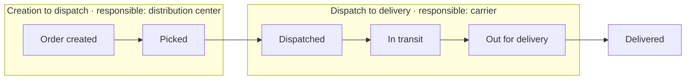
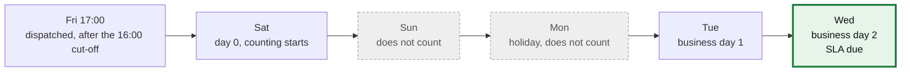

# Order tracking, delay time and responsibility

Part of the data model work of `US-04` and of rules RN-03, RN-04, RN-05 and RN-07. It explains who is responsible at each
stage of an order and how the SLA clock runs in business days.

## Who is responsible at each stage

| Stage | Responsible |
|---|---|
| Creation to dispatch | Distribution center (`CD`) |
| Dispatch to delivery | Carrier (`TRANSPORTADORA`) |
| An open issue caused by a wrong address | Brand (`MARCA`) |
| An open issue with any other cause | Carrier |

The SLA clock counts **business days, without Sundays or public holidays of the destination country**. An issue can happen
at any stage.

## Measuring time

| Measure | Formula |
|---|---|
| Distribution center time | dispatch − creation |
| Carrier time | delivery − dispatch |
| Delay | delivery − deadline |

## At-risk orders (RN-04)

An order is at risk when either condition holds:

- **24 business hours or less** remain before the deadline and the order is **not** out for delivery.
- An issue (`NOVEDAD`) has been **open for more than 12 hours**.

The exact meaning of "24 business hours" is still an open decision. See [Business rules](./business-rules.md#open-ambiguities)
(AMB-02).

## Orders with several guides (RN-07)

An order meets the SLA only if **every** guide is delivered on time. One late guide makes the whole order non-compliant.

## Worked example (acceptance criterion CA-02)

An order is dispatched on **Friday at 17:00**. Its SLA is **2 business days**, and **Monday is a holiday**.

**Result: the deadline is Wednesday.**

| Day | What happens |
|---|---|
| Friday 17:00 | Dispatch happens after the 16:00 cut-off |
| Saturday | Day 0: counting starts on the next business day |
| Sunday | Does not count |
| Monday | Holiday, does not count |
| Tuesday | Business day 1 |
| Wednesday | Business day 2: the SLA is due |

Everything is stored in UTC. The 16:00 cut-off and the holidays are applied using the time zone and the destination country of
each order. If the distribution center is in one country and the destination in another, the clock uses the **destination**
calendar (RN-03). See [ADR-0010](../decisions/0010-utc-and-business-calendars.md).

## How the seed data exercises it

The `cargaexpress_seed` project creates fixed scenario orders so these rules can be tested. For example, `SCN-02` is the
Friday 17:00 case with a Monday holiday, `SCN-06` is an order with two guides where one is late, and `SCN-12` has a
distribution center in Mexico and a destination in Peru. See [Seed data](./seed-data.md).

## Related

[Business rules](./business-rules.md) · [Data model](./data-model.md) · [Data flow](./data-flow.md)
